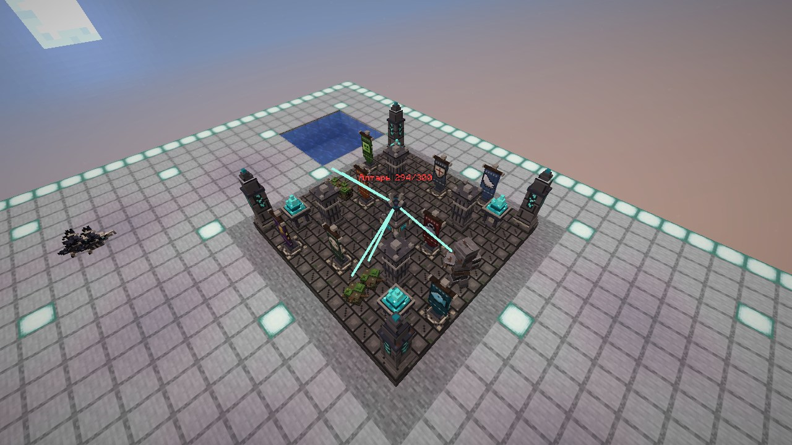
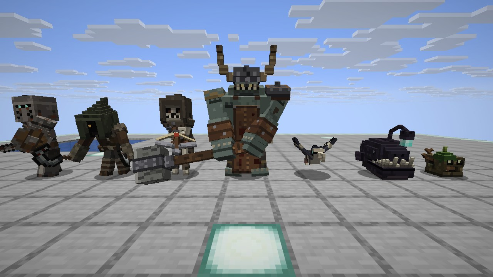
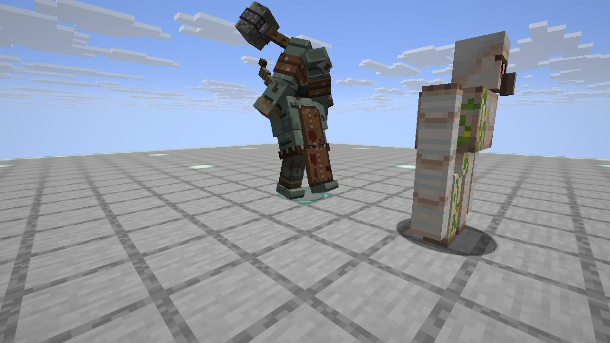
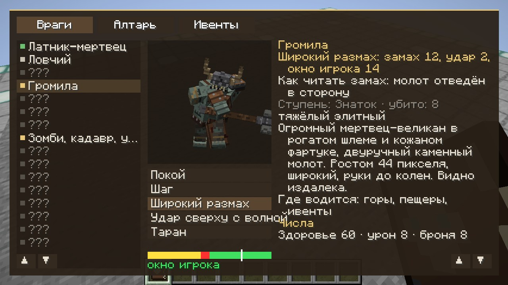

<div align="center">

[Русский](README.md) · **English**

# SoulsCraft

**Souls-like enemies and a summoning altar with wave events for Minecraft on [Horizon](https://github.com/horizon-rust/horizon).**<br>
Every enemy blow shows itself first: a windup, the blow, then a window to answer. Read the windup, strike in the window, then call the waves to your altar.

[](https://github.com/Betreazen/soulscraft/releases/latest)


[Install](#install) · [Handbook](https://betreazen.github.io/soulscraft/showcase/) · [How to play](#how-to-play) · [For servers](#for-server-owners) · [Changelog](CHANGELOG.md)



</div>

> The mod's in-game text is Russian for now; the design documents in `docs/` are in Russian too.

## What it is

SoulsCraft adds enemies you read rather than out-click. Every attack has a windup with a pose and a sound you learn to know, sometimes a held beat, the blow itself and a recovery that leaves the enemy open. Attack numbers live in one data file and count in ticks, so a windup is the same on every server.

- **Seven new mobs.** A shielded revenant, a stalker with sickles, a bone marksman, a brute with a stone maul, a shrike, a deep lurker and a bog slime. Each has its own model, animations, held weapon, hitbox that fits the model and sounds. Each behaves as the handbook says: the revenant follows you through its held beat and knocks your shield down, the stalker flanks, the marksman hides behind cover to reload, the brute's shockwave can be jumped, shrikes dive in turns, the lurker grabs and pulls you down.
- **Vanilla mobs learn too.** The zombie lunges, the spider pounces, the vindicator brings an overhead down, the witch winds up a potion: 19 vanilla types get moves with the same honest windup. Their models and the rest of their behaviour stay vanilla.
- **Enemies grow with you.** Enemy strength follows the players nearby: their armour, weapons and, with [Path-of-craft-tree](https://github.com/Betreazen/path-of-craft-tree) installed, their skill-tree levels.
- **The mobs live in the world.** At night and in their biomes SoulsCraft's mobs come by themselves: the revenant wherever zombies spawn, the stalker in forests, the shrike high in the mountains (in pairs or threes), the lurker in the deep ocean. A mob comes only when a player with strength at or above its tier is nearby: a weak player will not meet a brute. A mob you kill sometimes drops a **soul shard**, which the altar is built from.
- **The summoning altar.** A build of up to 9 × 9 from a core, slabs, pillars, braziers and obelisks. Levels 1–4 come from its rings and an open sky. A horn on the pedestal starts an event: waves walk to the altar from spawn points shown in advance and drain its power. Hold the altar until the waves run out. The altar menu names the events and horns of all tiers, the event panel shows the wave and the event name, the zone border is drawn for the first seconds, rests between waves are random, 30 to 45 s. The enemies' strength is the mean strength of all participants.
- **Four tiers of events.** The Rotten Horn calls zombies, the Grave Horn the Night of the Dead, the Storm Horn the Claw Storm, the Abyss Horn the Last Stand: eight waves, the last with three brutes. A head from one tier's event goes into the next tier's horn.
- **Horns are found, not only crafted.** Each tier has its structures: the Rotten Horn lies in dungeons and mineshafts, the Abyss Horn in ancient cities and bastion treasure rooms. Mobs drop a horn now and then too.
- **Each tier has its reward.** A win gives soul shards and, by chance, the tier's own item: the Revenant's Blade, the Brute's Maul or the Abyss Heart. "Harder" banners raise the chance.
- **12 banner modifiers.** Weight and mercy, horde and calm, haste and rest, resilience and five kin banners. They change the enemies' strength, number and kind, the rests between waves and the reward.
- **Trophies.** A win brings mob heads (on the floor, on a wall or on your head), pieces of their armour and, on a level-three altar, a diorama: a piece of the mob's home on a plinth, the mob in its trophy pose, its own light and particles. The brass plaque shows the mob's name, the trophy's owner and how many of them they have killed.
- **The hunter's book.** Entries open as you meet and kill: met, killed, studied, expert. The book plays the mob's live model through its attacks, and a phase strip shows when to strike.
- **More spawns round the altar.** At night monsters of other biomes and SoulsCraft mobs come near an altar.
- **A handbook in the browser.** The mobs' models and every attack, the four events, altar defence, vanilla mobs, items and 24 recipes, trophies and a mock-up of the book: the [handbook](https://betreazen.github.io/soulscraft/showcase/) (in Russian). It reads its numbers from the same data files as the mod.
- **Plays well with other mods.** Enemy strength reads the Path-of-craft-tree tree, and kills by RustCraft turrets and guards count in their owner's book. The `soulscraft:bleeding` effect is shared by both mods.

<table>
<tr>
<td width="50%"></td>
<td width="50%"></td>
</tr>
<tr>
<td align="center"><b>Bestiary</b>: the seven mobs of the first slice</td>
<td align="center"><b>Windup</b>: the maul is up, the slam and its shockwave come next</td>
</tr>
<tr>
<td width="50%"></td>
<td width="50%"></td>
</tr>
<tr>
<td align="center"><b>Dioramas</b>: the level-three altar's trophy</td>
<td align="center"><b>Hunter's book</b>: model, attacks and the window to answer</td>
</tr>
</table>

## Bestiary

| Mob | Role | Habitat | Attacks |
| --- | --- | --- | --- |
| **Revenant** | shielded duellist | the surface at night | thrust, slash, held overhead, shield bash (knocks back, knocks the shield down) |
| **Stalker** | fast skirmisher | forests, taiga, jungle | double sickle slash with bleeding, dash lunge; flanks from the side and behind |
| **Bone marksman** | archer | plains, badlands, mountains | aimed shot, stock strike; hides behind cover to reload |
| **Brute** | heavy elite | mountain peaks, caves, events | wide swing, overhead slam with a shockwave (can be jumped), charge, a roar in its rage |
| **Shrike** | diving hunter | mountains, windswept hills, at night | dive, in turns; dodge when the wings fold |
| **Deep lurker** | ambush predator | deep ocean below Y 40 | ambush lunge, a 40-tick grab (three blows free you) |
| **Bog slime** | area damage, splits | swamps | high jump with a landing shadow, the wave slows |

Vanilla moves: the zombie's lunge and the drowned's trident throw, the spider's pounce, the witch's potion throw, the pillager's shot, the vindicator's held overhead, the piglin brute's heavy strike, the hoglin's charge, the wither skeleton's two-blow series, the slime's big jump and the phantom's cry before its dive. The skeleton keeps its distance and backs off after a shot.

## How to play

| What | How |
| --- | --- |
| Hunter's book | shapeless recipe: a book and rotten flesh; right-click opens it |
| First altar | hunt soul shards at night, then craft a core, a pedestal and 8 slabs from deepslate bricks: a level-1 altar |
| Start an event | a horn of its tier on the altar's pedestal, right-click; the altar's level must be at least the horn's tier |
| Altar menu | right-click the core with an empty hand: level, banners, spawn boost, the events and horns of each tier |
| Extend the altar | hold an altar block: a ghost shows where the next ring goes |
| Survive an attack | the windup has a pose and a sound: step away or raise a shield, then strike in the recovery |
| Dying in an event | never kills you, not even in hardcore: the altar carries you out of the zone at 1 health and heals you, and you keep your items |

Every recipe is in the game's recipe book and in the [slice spec](docs/design/10-survival.md) (Russian). Every balance number is a hypothesis the playtest will check.

## Install

You need the [Horizon launcher](https://github.com/horizon-rust/horizon) 0.2.96 or newer, the Horizon Nightly 2026-11-21 build (commit `8f83e5c`) and a licensed Minecraft: Java Edition account.

> [!WARNING]
> Horizon native mods are compiled into the game and run with your rights, unsandboxed. Read the code before installing; the launcher asks you to confirm that you trust the mod. See [SECURITY.md](SECURITY.md).

Since 0.8.0 SoulsCraft is one Horizon Mod API package: the folder [`mod/soulscraft`](mod/soulscraft) with its `horizon-mod.toml` manifest, a Rust crate and its resources (`assets/`, `data/`). Mob types, models, textures and blocks are in the same package; there is no separate content mod any more. The launcher compiles only the mod against the prebuilt game. The mod is needed both in the game and on the server.

The mod is pinned to one Horizon build (`[native] horizon` in [`horizon-mod.toml`](mod/soulscraft/horizon-mod.toml)); another build needs a rebuild. Versions 0.7.1 and older use the old bundle format (Horizon `7e4e421`, launcher 0.2.58), which newer Horizon builds don't load.

> [!IMPORTANT]
> For now SoulsCraft can't be built into one game or one server with other native mods (RustCraft, Path-of-craft-tree, LetsCam): two native mods in one build don't link ([horizon#19616](https://github.com/horizon-rust/horizon/issues/19616)). Until Horizon fixes it, install SoulsCraft on its own.

### Single player and LAN

```powershell
git clone https://github.com/Betreazen/soulscraft
horizon-launcher native-build soulscraft/mod/soulscraft --version nightly-2026-11-21-8f83e5c --trust-native-code
```

`native-build` builds the mod and selects that build for the launcher's instance; then play as usual. The first build downloads the SDK and Rust and takes a few minutes; a rebuild after an edit takes about a minute.

### Dedicated server

A server with native mods is built for Linux x86-64 only: the dedicated-server SDK exists for Linux alone, and the launcher refuses that export on Windows.

```bash
git clone https://github.com/Betreazen/soulscraft
horizon-launcher native-build soulscraft/mod/soulscraft \
    --server-output /srv/horizon-engines/soulscraft-0.8.0 --version nightly-2026-11-21-8f83e5c --trust-native-code
horizon-server --dir <server folder> config set engine.path=/srv/horizon-engines/soulscraft-0.8.0/horizon-engine
horizon-server --dir <server folder> restart
```

The `--server-output` folder must not exist yet. Players need the same mod version on the same Horizon build: the client draws the models and windows.

## For server owners

### Commands

The `/sc` commands are for operators of level 2 and up and for the console.

| Command | What it does |
| --- | --- |
| `/sc spawn <mob> [strength] [count]` · `/sc clear` | Spawn SoulsCraft mobs nearby · remove the mod's mobs around |
| `/sc force <attack>` | Make the nearest mob perform an attack, vanilla ones included |
| `/sc debug on` · `off` | Attack phase labels over mobs |
| `/sc log on` · `off` | A server log line for every mob's spawn, phase and blow. Off by default, so a live server's log stays clean |
| `/sc altar <level> [banners]` | Build an altar of that level nearby for testing |
| `/sc event` · `/sc event stop` | Start or stop the test event at the nearest altar |
| `/sc book <player> [action]` | Show or change a player's hunter's book progress |
| `/sc power` · `/sc p <strength>` | Show the strength of players nearby · set enemy strength by hand |
| `/sc info` | How many of the mod's mobs and changed vanilla mobs are in the world |
| `/sc reload` | Re-read `config/soulscraft/mobs.json` in the server folder without a restart |
| `soulscraft_selftest run [filter]` | The console or a level-4 player (cheats on in single player): the in-world self-test, 105 scenarios of attacks, the altar, events, trophies and the book |

### Numbers without a rebuild

Every mob, attack and event number lives in [`data/mobs.json`](data/mobs.json) (format in [`data/README.md`](data/README.md)). To change them on a server, put the edited file at `config/soulscraft/mobs.json` and run `/sc reload`. If the file is there at start-up, the server uses it.

### Player data

Hunter's book progress is kept in player data (`soulscraft:book`) and survives a relog. The mod opens no network connections of its own.

## For developers

```powershell
cd mod/soulscraft
cargo horizon-mod check     # once: fetch the pinned SDK into .horizon/
cargo test --lib            # the game-free rules: attacks, mob minds, the altar, events, the book, trophies, loot
```

- **Rules without the game.** All logic lives in the mod's crate [`soulscraft-rules`](mod/soulscraft/src) and is checked by `cargo test --lib` in `mod/soulscraft`; the modules that hold `Game` only pass events on.
- **One source of numbers.** [`data/mobs.json`](data/mobs.json), [`data/altar.json`](data/altar.json), [`data/trophies.json`](data/trophies.json) and [`data/book.json`](data/book.json) feed the server, Blender and the showcase.
- **Models from code.** Mobs, blocks and trophies are built by Blender scripts: [`assets/models/README.md`](assets/models/README.md).
- **In-game checks.** The `soulscraft_selftest run` self-test in single player and on a Linux dedicated server ([`tools/linux-selftest.sh`](tools/linux-selftest.sh)). How the package is laid out, which Horizon functions it takes, how to build it and what tripped us up moving to the Mod API: [`mod/README.md`](mod/README.md) (in Russian).

See [CONTRIBUTING.md](CONTRIBUTING.md) to help out.

## Rights

No license is chosen: the code is open to read and to install the mod from, and all rights stay with the author. Minecraft is a trademark of Mojang Studios. SoulsCraft is not affiliated with Mojang or Microsoft.
