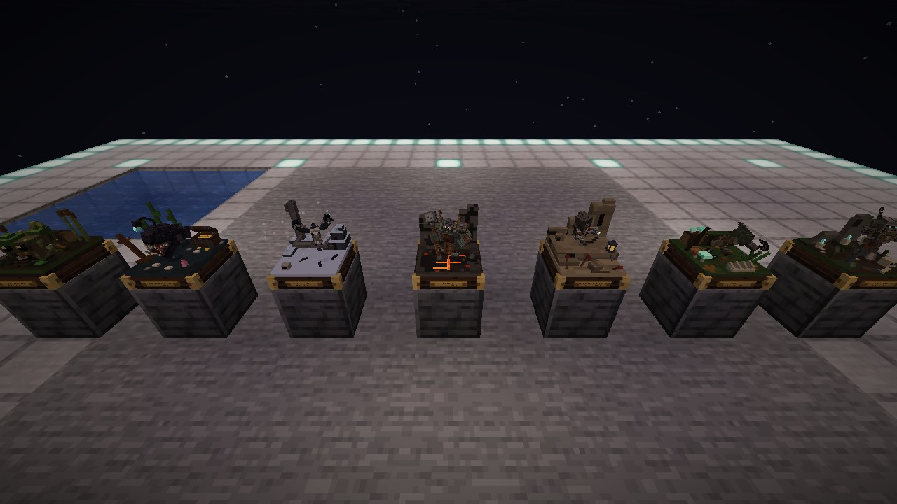

<div align="center">

[Русский](README.md) · **English**

# SoulsCraft

**Souls-like enemies and a summoning altar with wave events for Minecraft on [Horizon](https://github.com/horizon-rust/horizon).**<br>
Every enemy blow shows itself first: a windup, the blow, then a window to answer. Read the windup, strike in the window, then call the waves to your altar.

[](https://github.com/Betreazen/soulscraft/releases/latest)


[Install](#install) · [Bestiary showcase](https://betreazen.github.io/soulscraft/showcase/) · [How to play](#how-to-play) · [For servers](#for-server-owners) · [Changelog](CHANGELOG.md)


</div>

> The mod's in-game text is Russian for now; the design documents in `docs/` are in Russian too.

## What it is

SoulsCraft adds enemies you read rather than out-click. Every attack has a windup with a pose and a sound you learn to know, sometimes a held beat, the blow itself and a recovery that leaves the enemy open. Attack numbers live in one data file and count in ticks, so a windup is the same on every server.

- **Seven new mobs.** A shielded revenant, a stalker with sickles, a bone marksman, a brute with a stone maul, a shrike, a deep lurker and a bog slime. Each has its own model, animations, held weapon and a hitbox that fits the model.
- **Vanilla mobs learn too.** The zombie lunges, the spider pounces, the vindicator brings an overhead down, the witch winds up a potion: 19 vanilla types get moves with the same honest windup. Their models and the rest of their behaviour stay vanilla.
- **Enemies grow with you.** Enemy strength follows the players nearby: their armour, weapons and, with [Path-of-craft-tree](https://github.com/Betreazen/path-of-craft-tree) installed, their skill-tree levels.
- **The mobs live in the world.** At night and in their biomes SoulsCraft's mobs come by themselves: the revenant wherever zombies spawn, the stalker in forests, the shrike high in the mountains, the lurker in the deep ocean. A mob you kill sometimes drops a **soul shard**, which the altar is built from.
- **The summoning altar.** A build of up to 9 × 9 from a core, slabs, pillars, braziers and obelisks. Levels 1–4 come from its rings and an open sky. A horn on the pedestal starts an event: waves walk to the altar from spawn points shown in advance and drain its power. Hold the altar until the waves run out.
- **Four tiers of events.** The Rotten Horn calls zombies, the Grave Horn the Night of the Dead, the Storm Horn the Claw Storm, the Abyss Horn the Last Stand: eight waves with three brutes. A head from one tier's event goes into the next tier's horn.
- **12 banner modifiers.** Weight and mercy, horde and calm, haste and rest, resilience and five kin banners. They change the enemies' strength, number and kind, the rests between waves and the reward.
- **Trophies.** A win brings mob heads (on the floor, on a wall or on your head), pieces of their armour and, on a level-three altar, a diorama: a piece of the mob's home on a plinth, the mob in its trophy pose, its own light and particles. The brass plaque shows the mob's name, the trophy's owner and how many of them they have killed.
- **The hunter's book.** Entries open as you meet and kill: met, killed, studied, expert. The book plays the mob's live model through its attacks, and a phase strip shows when to strike.
- **More spawns round the altar.** At night monsters of other biomes and SoulsCraft mobs come near an altar.
- **Plays well with other mods.** Enemy strength reads the Path-of-craft-tree tree, and kills by RustCraft turrets and guards count in their owner's book. The `soulscraft:bleeding` effect is shared by both mods.

<table>
<tr>
<td width="50%"></td>
<td width="50%"></td>
</tr>
<tr>
<td align="center"><b>Bestiary</b>: the seven mobs of the first slice</td>
<td align="center"><b>Windup</b>: the maul is up, the slam and its shockwave come next</td>
</tr>
<tr>
<td width="50%"></td>
<td width="50%"></td>
</tr>
<tr>
<td align="center"><b>Dioramas</b>: the level-three altar's trophy</td>
<td align="center"><b>Hunter's book</b>: model, attacks and the window to answer</td>
</tr>
</table>

## Bestiary

| Mob | Role | Habitat | Attacks |
| --- | --- | --- | --- |
| **Revenant** | shielded duellist | the surface at night | thrust, slash, held overhead, shield bash |
| **Stalker** | fast skirmisher | forests, taiga, jungle | double sickle slash with bleeding, dash lunge |
| **Bone marksman** | archer | plains, badlands, mountains | aimed shot, stock strike |
| **Brute** | heavy elite | mountain peaks, caves, events | wide swing, overhead slam with a shockwave, charge |
| **Shrike** | diving hunter | mountains, windswept hills, at night | dive |
| **Deep lurker** | ambush predator | deep ocean below Y 40 | ambush lunge, grab |
| **Bog slime** | area damage, splits | swamps | high jump |

Vanilla moves: the zombie's lunge and the drowned's trident throw, the spider's pounce, the witch's potion throw, the pillager's shot, the vindicator's held overhead, the piglin brute's heavy strike, the hoglin's charge, the wither skeleton's two-blow series, the slime's big jump and the phantom's cry before its dive. The skeleton keeps its distance and backs off after a shot.

## How to play

| What | How |
| --- | --- |
| Hunter's book | shapeless recipe: a book and rotten flesh; right-click opens it |
| First altar | hunt soul shards at night, then craft a core, a pedestal and 8 slabs from deepslate bricks: a level-1 altar |
| Start an event | a horn of its tier on the altar's pedestal, right-click; the altar's level must be at least the horn's tier |
| Altar menu | right-click the core with an empty hand: level, banners, spawn boost |
| Extend the altar | hold an altar block: a ghost shows where the next ring goes |
| Survive an attack | the windup has a pose and a sound: step away or raise a shield, then strike in the recovery |
| Dying in an event | never kills you, not even in hardcore: the altar carries you out of the zone at 1 health and heals you, and you keep your items |

Every recipe is in the game's recipe book and in the [slice spec](docs/design/10-survival.md) (Russian). Every balance number is a hypothesis the playtest will check.

## Install

You need the [Horizon launcher](https://github.com/horizon-rust/horizon) and a licensed Minecraft: Java Edition account.

> [!WARNING]
> Horizon native mods are compiled into the game and run with your rights, unsandboxed. Read the code before installing; the launcher asks you to confirm that you trust the mod. See [SECURITY.md](SECURITY.md).

The mod has two parts with one id, `soulscraft`: the native bundle [`mod/soulscraft`](mod/soulscraft) (the server runs the attacks, the client draws the models) and the content mod [`mod/content`](mod/content) (mob types, models, textures, blocks). It is needed both in the game and on the server.

### Single player and LAN

**In the launcher:** Mods → **Add from GitHub** → paste `https://github.com/Betreazen/soulscraft` → **Build**.

**From the command line:**

```powershell
horizon-launcher mods add-github https://github.com/Betreazen/soulscraft --trust-native-code
horizon-launcher native-build --trust-native-code
```

The launcher takes the [latest release](https://github.com/Betreazen/soulscraft/releases/latest). The first build downloads Rust and takes 20–30 minutes; later ones are faster. The mod builds on the Horizon commit it pins (`[compatibility] horizon_revision` in [`mod/soulscraft/horizon-mixin.toml`](mod/soulscraft/horizon-mixin.toml)). If your other native mods pin another commit, the launcher offers **Build anyway**.

### Dedicated server

```powershell
git clone --branch v0.5.0 https://github.com/Betreazen/soulscraft
horizon-launcher native-build soulscraft/mod/soulscraft `
    --server-output C:\horizon-engines\soulscraft-0.5.0 --version <Horizon version> --trust-native-code
horizon-server --dir <server folder> config set engine.path=C:\horizon-engines\soulscraft-0.5.0\horizon-engine.exe
horizon-server --dir <server folder> restart
```

The `--server-output` folder must not exist yet. To build a server with several mods, for example with Path-of-craft-tree and RustCraft, put their folders side by side and pass the common folder to `native-build`. See [Horizon's native mod docs](https://github.com/horizon-rust/horizon/blob/main/docs/native-mods.md#standalone-server-export).

Players need the same version of the mod in their game: the client draws the models and windows.

## For server owners

### Commands

The `/sc` commands are for operators of level 2 and up and for the console.

| Command | What it does |
| --- | --- |
| `/sc spawn <mob> [strength] [count]` · `/sc clear` | Spawn SoulsCraft mobs nearby · remove the mod's mobs around |
| `/sc force <attack>` | Make the nearest mob perform an attack, vanilla ones included |
| `/sc debug on` · `off` | Attack phase labels over mobs |
| `/sc log on` · `off` | A server log line for every mob's spawn, phase and blow. Off by default, so a live server's log stays clean |
| `/sc altar <level> [banners]` | Build an altar of that level nearby for testing |
| `/sc event` · `/sc event stop` | Start or stop the test event at the nearest altar |
| `/sc book <player> [action]` | Show or change a player's hunter's book progress |
| `/sc power` · `/sc p <strength>` | Show the strength of players nearby · set enemy strength by hand |
| `/sc info` | How many of the mod's mobs and changed vanilla mobs are in the world |
| `/sc reload` | Re-read `config/soulscraft/mobs.json` in the server folder without a restart |
| `soulscraft_selftest run [filter]` | Console only: the in-world self-test, 86 scenarios of attacks, the altar, events, trophies and the book |

### Numbers without a rebuild

Every mob, attack and event number lives in [`data/mobs.json`](data/mobs.json) (format in [`data/README.md`](data/README.md)). To change them on a server, put the edited file at `config/soulscraft/mobs.json` and run `/sc reload`. If the file is there at start-up, the server uses it.

### Player data

Hunter's book progress is kept in player data (`soulscraft:book`) and survives a relog. The mod opens no network connections of its own.

## For developers

```powershell
cargo test     # the game-free rules: attacks, mob minds, the altar, events, the book, trophies
```

- **Rules without the game.** All logic lives in the [`soulscraft-rules`](mod/soulscraft/rules) crate and is checked by `cargo test`; the modules that hold `Game` only pass events on.
- **One source of numbers.** [`data/mobs.json`](data/mobs.json), [`data/altar.json`](data/altar.json), [`data/trophies.json`](data/trophies.json) and [`data/book.json`](data/book.json) feed the server, Blender and the showcase.
- **Models from code.** Mobs, blocks and trophies are built by Blender scripts: [`assets/models/README.md`](assets/models/README.md).
- **In-game checks.** The bench self-test and bot clients with screenshots: [`prototypes/README.md`](prototypes/README.md). How the code is laid out and which Horizon hooks it takes: [`mod/README.md`](mod/README.md).

See [CONTRIBUTING.md](CONTRIBUTING.md) to help out.

## Rights

No license is chosen: the code is open to read and to install the mod from, and all rights stay with the author. Minecraft is a trademark of Mojang Studios. SoulsCraft is not affiliated with Mojang or Microsoft.
