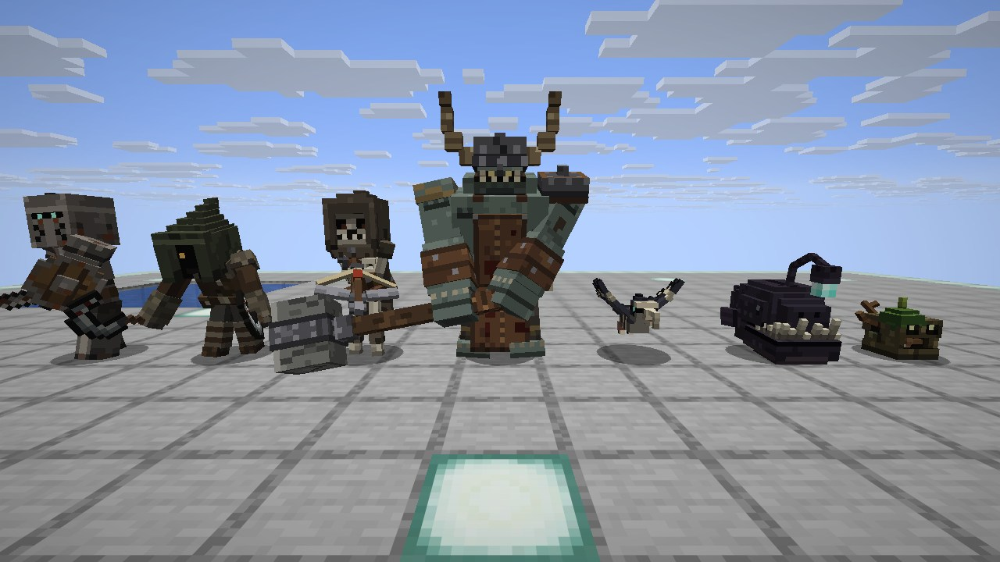
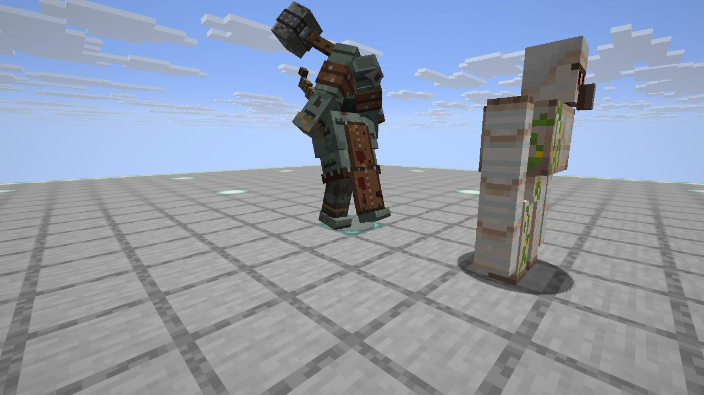
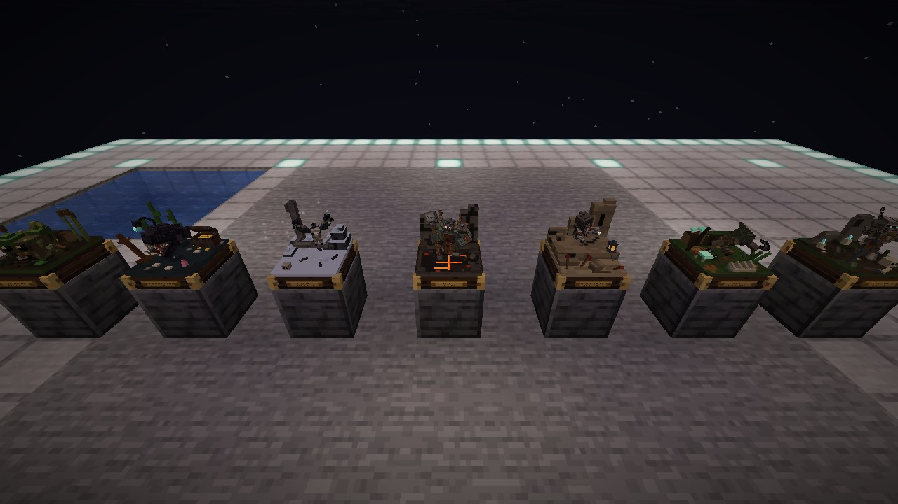
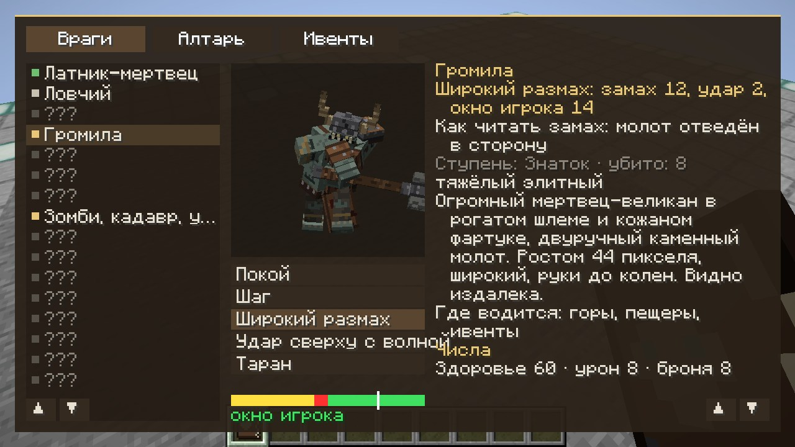

<div align="center">

**Русский** · [English](README.en.md)

# SoulsCraft

**Враги в духе souls-like и алтарь призыва с ивентами-волнами для Minecraft на [Horizon](https://github.com/horizon-rust/horizon).**<br>
Каждый удар врага виден заранее: замах, удар и окно для ответа. Читайте замах, бейте в окно, а потом зовите волны к своему алтарю.

[](https://github.com/Betreazen/soulscraft/releases/latest)


[Установка](#установка) · [Справочник](https://betreazen.github.io/soulscraft/showcase/) · [Как играть](#как-играть) · [Для серверов](#для-владельцев-серверов) · [Изменения](CHANGELOG.md) · [Концепт](docs/design/02-one-sheet.md)


</div>

## Что это

SoulsCraft добавляет врагов, которых нужно читать, а не закликивать. У каждой атаки есть замах с узнаваемой позой и звуком, иногда задержка, сам удар и восстановление, в котором враг открыт. Числа атак лежат в одном файле данных и считаются в тиках, поэтому замах одинаков на любом сервере.

- **Семь своих мобов.** Латник-мертвец со щитом, ловчий с серпами, костяной арбалетчик, громила с каменным молотом, сорокопут, глубинный удильщик и топяная слизь. У каждого своя модель, анимации, оружие в руке, рамка столкновений по модели и свои звуки. Каждый ведёт себя так, как написано в справочнике: латник в паузе идёт за игроком и выбивает щит, ловчий заходит сбоку, арбалетчик прячется за укрытие на перезарядке, волну громилы можно перепрыгнуть, сорокопуты пикируют по очереди, удильщик хватает и тянет вниз.
- **Ванильные мобы тоже учатся.** Зомби делает выпад, паук прыгает, поборник бьёт сверху, ведьма замахивается зельем: 19 ванильных типов получают свои приёмы с тем же честным замахом. Модели и остальное поведение у них ванильные.
- **Враги растут вместе с вами.** Сила врагов зависит от силы игроков рядом: от брони, оружия и, если установлен [Path-of-craft-tree](https://github.com/Betreazen/path-of-craft-tree), от уровней дерева.
- **Мобы живут в мире.** Ночью и в своих биомах приходят мобы SoulsCraft: латник везде, где спавнится зомби, ловчий в лесах, сорокопут высоко в горах (парой или тройкой), удильщик в глубоком океане. Моб приходит, только если рядом есть игрок с силой не ниже его ступени: слабый игрок не встретит громилу. Убитый вами моб иногда роняет **осколок души**: из осколков строят алтарь.
- **Алтарь призыва.** Постройка до 9 × 9 из ядра, плит, колонн, жаровен и обелисков. Уровни 1–4 считаются по кольцам и открытому небу. Горн на подставке начинает ивент: волны врагов идут к алтарю из точек, видных заранее, и тянут из него силу. Защищайте алтарь, пока не кончатся волны. Меню алтаря называет ивенты и горны всех ступеней, панель ивента — волну и имя ивента, границу зоны видно первые секунды, передышки между волнами случайные, 30–45 с. Сила врагов — средняя сила всех участников.
- **Четыре ступени ивентов.** Гнилой горн зовёт зомби, Горн мертвецов — «Ночь мертвецов», Горн бури — «Бурю когтей», Горн бездны — «Последний рубеж» из восьми волн, в последней три громилы. Голова моба из ивента одной ступени нужна для горна следующей.
- **Горны находят, а не только крафтят.** У каждой ступени свои структуры: Гнилой горн лежит в подземельях и шахтах, Горн бездны — в древних городах и сокровищницах бастионов. Изредка горн роняют и мобы.
- **У каждой ступени своя награда.** Победа даёт осколки души и с шансом предмет ступени: Клинок латника, Молот громилы или Сердце бездны. Знамёна «сложнее» поднимают шанс.
- **12 знамён-модификаторов.** Тяжесть и милость, орда и затишье, спешка и отдых, стойкость и пять знамён рода. Знамёна меняют силу, число и состав врагов, передышки и награду.
- **Трофеи.** Победа приносит головы мобов (на пол, на стену или на голову), части их брони, а на алтаре третьего уровня — диораму: кусочек родных мест моба на подставке, моб в трофейной позе, свой свет и свои частицы. На латунной табличке — имя моба, имя владельца трофея и сколько таких он убил.
- **Книга охотника.** Записи открываются по встречам и убийствам: «Встречен», «Убит», «Изучен», «Знаток». В книге живая модель моба проигрывает его атаки, а шкала фаз показывает, когда бить.
- **Учащённый спавн у алтаря.** Ночью рядом с алтарём приходят монстры других биомов и мобы SoulsCraft.
- **Справочник в браузере.** Модели и все атаки мобов, четыре ивента, оборона алтаря, ванильные мобы, предметы и 24 рецепта, трофеи, макет книги: [справочник](https://betreazen.github.io/soulscraft/showcase/). Числа он читает из тех же файлов данных, что и мод.
- **Дружит с другими модами.** Сила врагов учитывает дерево Path-of-craft-tree, а убийства турелями и стражами RustCraft засчитываются в книгу их владельца. Кровотечение `soulscraft:bleeding` общее для обоих модов.

<table>
<tr>
<td width="50%"></td>
<td width="50%"></td>
</tr>
<tr>
<td align="center"><b>Бестиарий</b>: семь мобов первого среза</td>
<td align="center"><b>Замах</b>: громила занёс молот, сейчас будет удар с волной</td>
</tr>
<tr>
<td width="50%"></td>
<td width="50%"></td>
</tr>
<tr>
<td align="center"><b>Диорамы</b>: трофей с алтаря третьего уровня</td>
<td align="center"><b>Книга охотника</b>: модель, атаки и окно для ответа</td>
</tr>
</table>

## Бестиарий

| Моб | Роль | Где водится | Атаки |
| --- | --- | --- | --- |
| **Латник-мертвец** | дуэлянт со щитом | поверхность ночью | укол, рубящий удар, задержанный удар сверху, удар щитом (отбрасывает, выбивает щит) |
| **Ловчий** | быстрый застрельщик | леса, тайга, джунгли | двойной взмах серпами с кровотечением, выпад-рывок; заходит сбоку и сзади |
| **Костяной арбалетчик** | стрелок | равнины, бесплодные земли, горы | прицельный выстрел, удар прикладом; на перезарядке прячется за укрытие |
| **Громила** | тяжёлый элитный | горы, пещеры, ивенты | широкий размах, удар сверху с волной (её можно перепрыгнуть), таран, рёв в ярости |
| **Сорокопут** | пикирующий охотник | горы, ветреные холмы, ночью | пике по очереди; уворот в момент, когда складываются крылья |
| **Глубинный удильщик** | засадный хищник | глубокий океан ниже Y = 40 | бросок из засады, хватка на 40 тиков (три удара освобождают) |
| **Топяная слизь** | урон по площади, делится | болота | высокий прыжок с тенью приземления, волна замедляет |

Ванильные приёмы: выпад и бросок трезубца у зомби и утопленника, прыжок паука, бросок зелья у ведьмы, выстрел разбойника, задержанный удар поборника, удар брута пиглинов, таран хоглина, серия иссушённого скелета, большой прыжок слизня, крик фантома перед пике. Скелет держит дистанцию и отходит после выстрела.

Модели, атаки и сцены поведения можно посмотреть в [справочнике](https://betreazen.github.io/soulscraft/showcase/): страницы мобов, ивентов, обороны алтаря, ванильных мобов и «Предметы и рецепты». Почему у мобов такие числа — в [бестиарии](docs/design/04-bestiary.md) и в [гипотезах баланса](docs/design/03-hypotheses.md).

## Как играть

| Что | Как |
| --- | --- |
| Книга охотника | рецепт без формы: книга и гнилая плоть; правая кнопка мыши открывает книгу |
| Первый алтарь | охотьтесь ночью за осколками души, затем ядро, подставка и 8 плит из глубинносланцевых кирпичей: алтарь уровня 1 |
| Начать ивент | горн своей ступени на подставку алтаря, правой кнопкой мыши; уровень алтаря должен быть не ниже ступени горна |
| Меню алтаря | правая кнопка мыши по ядру пустой рукой: уровень, знамёна, учащённый спавн, ивенты и горны каждой ступени |
| Достроить алтарь | возьмите блок алтаря в руку: призрак покажет, где встанет следующее кольцо |
| Пережить атаку | в замахе враг принимает позу и издаёт звук: отойдите или подставьте щит, а бейте в восстановление |
| Смерть в ивенте | не губит даже в хардкоре: алтарь выносит вас из зоны с 1 здоровьем и лечит, вещи остаются при вас |

Все рецепты — в книге рецептов игры и в [описании среза](docs/design/10-survival.md#рецепты-г9-г16). Все числа баланса — гипотезы, их проверит плейтест.

## Установка

Нужны [лаунчер Horizon](https://github.com/horizon-rust/horizon) 0.2.96 или новее, сборка Horizon Nightly 2026-11-21 (коммит `8f83e5c`) и лицензионный аккаунт Minecraft: Java Edition.

> [!WARNING]
> Нативные моды Horizon компилируются прямо в игру и работают с вашими правами, без песочницы. Перед установкой прочитайте код. Лаунчер попросит подтвердить, что вы доверяете моду. Подробнее — в [SECURITY.md](SECURITY.md).

С версии 0.8.0 SoulsCraft — один пакет Mod API Horizon: папка [`mod/soulscraft`](mod/soulscraft) с манифестом `horizon-mod.toml`, крейтом на Rust и ресурсами (`assets/`, `data/`). Типы мобов, модели, текстуры и блоки лежат в том же пакете, отдельного контент-мода больше нет. Лаунчер собирает только мод, игру он берёт готовой. Мод нужен и в игре, и на сервере.

Мод привязан к одной сборке Horizon (`[native] horizon` в [`horizon-mod.toml`](mod/soulscraft/horizon-mod.toml)). На другой сборке его нужно пересобрать. Версии 0.7.1 и старше — старый формат бандла (Horizon `7e4e421`, лаунчер 0.2.58): новые сборки Horizon их не загружают.

> [!IMPORTANT]
> Пока SoulsCraft нельзя собрать в одну игру или на один сервер с другими нативными модами (RustCraft, Path-of-craft-tree, LetsCam): два нативных мода в одной сборке не линкуются ([horizon#19616](https://github.com/horizon-rust/horizon/issues/19616)). До исправления в Horizon ставьте SoulsCraft отдельно.

### Одиночная игра и игра по сети с хостом

```powershell
git clone https://github.com/Betreazen/soulscraft
horizon-launcher native-build soulscraft/mod/soulscraft --version nightly-2026-11-21-8f83e5c --trust-native-code
```

`native-build` собирает мод и выбирает эту сборку для экземпляра лаунчера: дальше игра запускается как обычно. Первая сборка скачивает SDK и Rust и занимает несколько минут, пересборка после правки — около минуты.

### Выделенный сервер

Сервер с нативными модами собирается только под Linux x86-64: SDK выделенного сервера есть только для Linux, на Windows лаунчер такой экспорт не делает.

```bash
git clone https://github.com/Betreazen/soulscraft
horizon-launcher native-build soulscraft/mod/soulscraft \
    --server-output /srv/horizon-engines/soulscraft-0.8.0 --version nightly-2026-11-21-8f83e5c --trust-native-code
horizon-server --dir <папка сервера> config set engine.path=/srv/horizon-engines/soulscraft-0.8.0/horizon-engine
horizon-server --dir <папка сервера> restart
```

Папка `--server-output` не должна существовать заранее. Игрокам сервера нужен мод той же версии на той же сборке Horizon: модели и окна рисует клиент.

## Для владельцев серверов

### Команды

Команды `/sc` — для операторов уровня 2 и выше и для консоли.

| Команда | Что делает |
| --- | --- |
| `/sc spawn <моб> [сила] [число]` · `/sc clear` | Поставить мобов SoulsCraft рядом · убрать мобов мода вокруг |
| `/sc force <атака>` | Заставить ближайшего моба провести атаку, в том числе ванильного |
| `/sc debug on` · `off` | Подписи фаз атак над мобами |
| `/sc log on` · `off` | Строки о каждом мобе (появление, фазы, удары) в журнале сервера. По умолчанию выключены: журнал живого сервера остаётся чистым |
| `/sc altar <уровень> [banners]` | Построить рядом алтарь нужного уровня для проверки |
| `/sc event` · `/sc event stop` | Начать или остановить тестовый ивент у ближайшего алтаря |
| `/sc book <игрок> [действие]` | Показать или изменить прогресс книги охотника |
| `/sc power` · `/sc p <сила>` | Показать силу игроков рядом · задать силу врагов вручную |
| `/sc info` | Сколько мобов мода и изменённых ванильных сейчас в мире |
| `/sc reload` | Перечитать `config/soulscraft/mobs.json` в папке сервера без перезапуска |
| `soulscraft_selftest run [фильтр]` | Консоль или игрок с уровнем 4 (в одиночной игре — с читами): самотест в мире, 105 сценариев атак, алтаря, ивента, трофеев и книги |

### Числа без пересборки

Все числа мобов, атак и ивента лежат в [`data/mobs.json`](data/mobs.json), формат описан в [`data/README.md`](data/README.md). Чтобы поменять их на сервере, положите изменённый файл в `config/soulscraft/mobs.json` и выполните `/sc reload`. Если файл есть при запуске, сервер берёт его.

### Данные игроков

Прогресс книги охотника хранится в данных игрока (`soulscraft:book`) и переживает перезаход. Своих сетевых соединений мод не открывает.

## Для разработчиков

```powershell
cd mod/soulscraft
cargo horizon-mod check     # один раз: скачать закреплённый SDK в .horizon/
cargo test --lib            # правила без игры: атаки, мозг мобов, алтарь, ивент, книга, трофеи, лут
```

- **Правила без игры.** Вся логика — в крейте мода [`soulscraft-rules`](mod/soulscraft/src), её проверяет `cargo test --lib` в `mod/soulscraft`. Модули с `Game` только передают события.
- **Один источник чисел.** [`data/mobs.json`](data/mobs.json), [`data/altar.json`](data/altar.json), [`data/trophies.json`](data/trophies.json) и [`data/book.json`](data/book.json) читают сервер, Blender и витрина.
- **Модели кодом.** Мобы, блоки и трофеи строятся скриптами в Blender: [`assets/models/README.md`](assets/models/README.md).
- **Проверка в игре.** Самотест `soulscraft_selftest run` в одиночной игре и на выделенном сервере Linux ([`tools/linux-selftest.sh`](tools/linux-selftest.sh)). Как устроен пакет, какие функции Horizon он берёт, как его собрать и на чём мы споткнулись при переходе на Mod API — [`mod/README.md`](mod/README.md).

Как помочь проекту — в [CONTRIBUTING.md](CONTRIBUTING.md).

## Документы

| Документ | О чём |
| --- | --- |
| [Концепт](docs/design/02-one-sheet.md) | опыт игрока, цикл, опоры дизайна, риски |
| [Бестиарий](docs/design/04-bestiary.md) | семь мобов, их атаки, поведение и тестовый ивент |
| [Алтарь](docs/design/06-altar.md) | постройка, уровни, знамёна, ивент, учащённый спавн |
| [Ванильные мобы](docs/design/07-vanilla-mobs.md) | кто из ванильных получает приём и почему |
| [Книга охотника](docs/design/08-guide-book.md) | записи, ступени, засчитывание убийств |
| [Трофеи](docs/design/09-trophies.md) | головы, броня и диорамы |
| [Гипотезы баланса](docs/design/03-hypotheses.md) | числа до плейтеста и как их проверить |
| [Решения](docs/design/01-decisions.md) | журнал решений по раундам и открытые вопросы |
| [Стыковка с модами](docs/research/integration.md) | что даёт Horizon, как мод работает с Path-of-craft-tree, RustCraft и LetsCam |
| [Журнал разработки](docs/devlog.md) | что сделано по срезам и раундам |

## Права

Лицензия не выбрана: код открыт для чтения и для установки мода, все права у автора. Minecraft — товарный знак Mojang Studios. SoulsCraft не связан с Mojang и Microsoft.
